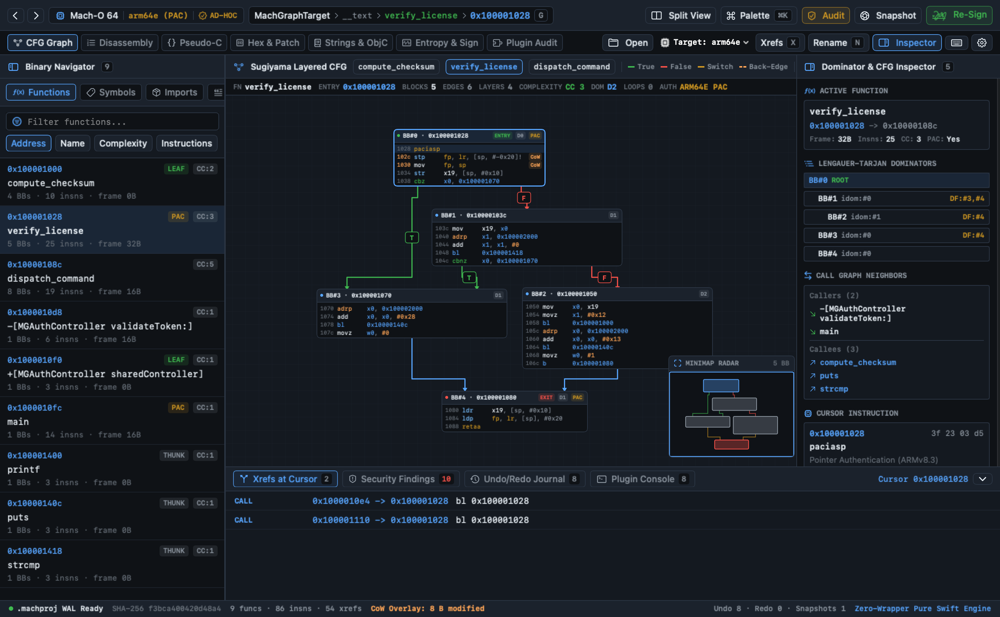
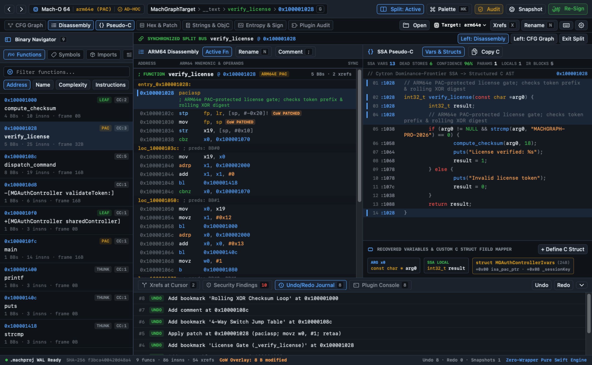
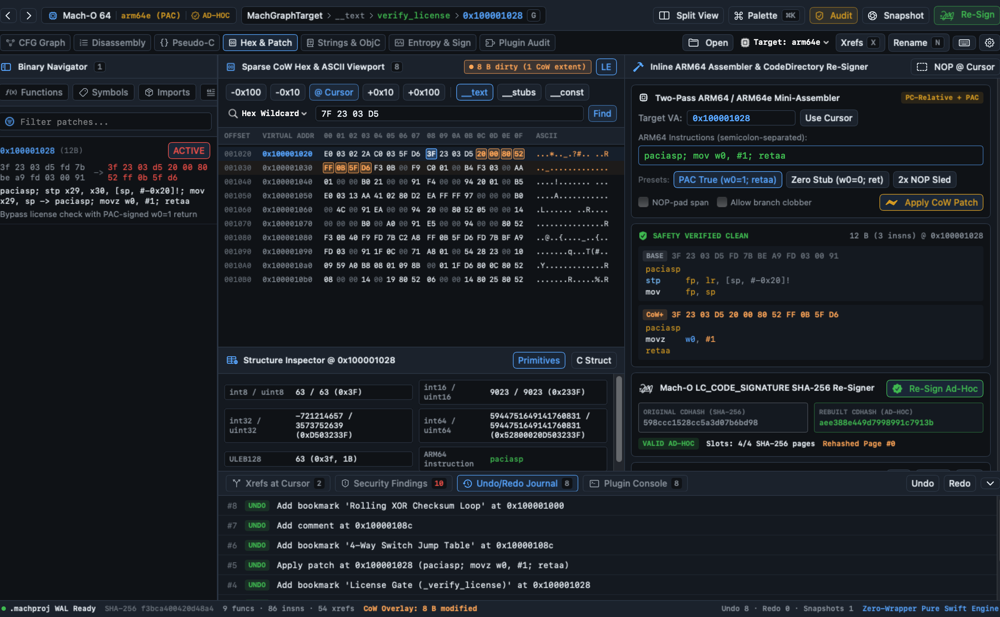
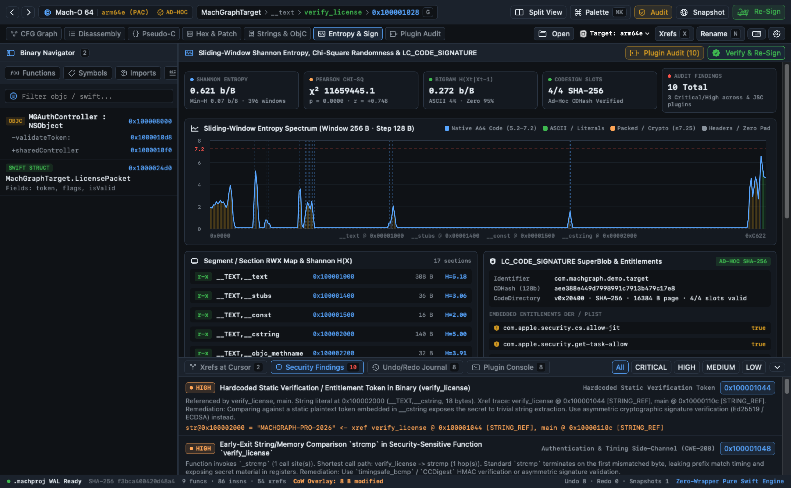

# MachGraph

**Zero-CLI-Wrapper Native Binary Reverse-Engineering IDE, ARM64 SSA Decompiler & Patch Workbench for macOS (Apple Silicon)**



`MachGraph` (`72,666 LOC` of strict Swift 6 across 11 modular libraries + native desktop IDE + 142 automated Swift Testing checks) is a standalone Apple Silicon reverse-engineering workbench built from first principles **without shelling out to `otool`, `objdump`, `nm`, `llvm-mc`, or `c++filt`**. Every container loader, ARM64/ARM64e PAC instruction decoder, two-pass inline mini-assembler, Lengauer-Tarjan dominator & Sugiyama Control-Flow Graph layout solver, Cytron SSA Micro-IR -> structured zero-`goto` Pseudo-C decompiler, sparse Copy-on-Write hex patcher, Mach-O `LC_CODE_SIGNATURE` SHA-256 re-signer, `.machproj` SQLite WAL database, and `JavaScriptCore` security analyzer sandbox runs natively in-process.

---

## Architecture (`72,666 LOC` Across 11 SwiftPM Modules + Executable + Test Suite)

| Module | LOC | Responsibility |
|---|---:|---|
| `MachBinaryFormats` | `9,200` | Universal Fat/Fat64, Mach-O 64, Dyld Chained Fixups (`ARM64E` PAC + `PTR_64`), Export Trie, Embedded `LC_CODE_SIGNATURE` CMS/DER/CDHash, ObjC 2.0 Runtime & Swift 5 Type Descriptors, ELF64, PE32+, WebAssembly 1.0 |
| `MachMicroDecompiler` | `8,864` | ARM64 -> Micro-IR lifter, Cytron dominance-frontier SSA $\phi$-placement, dead-store & copy propagation, structured `if / else / while / do-while / switch` Pseudo-C emitter (`0` `goto`s) + optional Ghidra 12.1.4 side-by-side bridge |
| `MachA64Decoder` | `8,817` | Handwritten ARMv8-A / ARMv8.3-A (`arm64e` PAC + LSE Atomics + SIMD/FP) decoder, two-pass inline ARM64 mini-assembler, `ADRP+ADD`/`ADRP+LDR` idiom recognizer, and pure-Swift `$s` + Itanium `_Z` + ObjC symbol demangler |
| `MachCFGEngine` | `8,207` | Function boundary & switch jump-table recovery, Lengauer-Tarjan dominator tree & `IDF+` dominance frontiers, natural loop detector, bidirectional Xref & Call Graph SCC index, Brandes-Köpf Sugiyama zero-overlap CFG layout |
| `MachProjectStore` | `7,551` | `.machproj` SQLite3 WAL persistence (`v1..v4` checksummed migrations), dual-indexed Xref queries, persistent Undo/Redo journal across cold restarts, atomic checkpoints, JSON / Ghidra / IDA / C-header / Markdown dossier export |
| `MachStudioViews` | `7,239` | Infinite pan/zoom Sugiyama CFG canvas + minimap radar, synchronized ARM64 <-> Pseudo-C split studio, 16-byte Sparse CoW Hex & Inline ARM64 Patcher, Strings/ObjC/Swift runtime browser, Sliding-Window Entropy & CodeSign studio |
| `MachPatchAndHexEngine` | `6,393` | $O(\log P)$ Sparse Copy-on-Write byte overlay, Horspool masked wildcard search, safety-checked inline ARM64 patcher + veneer stubs, IPS/IPS32/BPS1 patch codecs, Mach-O `CodeDirectory` SHA-256 re-signer, Shannon & $\chi^2$ entropy profiler |
| `MachWorkbenchShell` | `5,173` | Cold Tungsten Steel (`#0F1216`) workbench shell, synchronized cross-pane `VirtualAddress` cursor bus, `⌘K` Command Palette, `G` Go-To-Address/Symbol expression parser, `X` Xref jump modal, `⌘,` multi-tab preferences |
| `MachGraphModels` | `2,998` | Zero-copy `BinarySliceReader`, `VirtualAddress`/`FileOffset` arithmetic, ARM64 AST, CFG/Dominator/Loop models, SSA Micro-IR, Pseudo-C AST, Patch & SQLite WAL domain types |
| `MachPluginSDK` | `2,937` | Capability-gated `JavaScriptCore` reverse-engineering plugin host with 4 built-in security analyzers (Hardcoded Secret/Key Scanner, Dangerous C Sink Auditor, ARM64E PAC Gadget Inspector, Entitlement Privilege Escalation Analyzer) |
| `MachHeadlessCLI` | `996` | 15-subcommand headless CLI, JSON-RPC 2.0 MCP server (`stdio`) for AI coding agents, and Hallmark-clean standalone Cold-Tungsten HTML triage report exporter |
| `MachGraph` + `MachGraphTests` | `4,291` | Unified desktop/CLI/MCP entry point (`268` LOC) + **142 Swift Testing `@Test` checks across 7 suites** (`4,023` LOC, `0.74s`, `0` failures) |

---

## 2x Retina Workbench Gallery (`2720 × 1680`)

| Sugiyama CFG, Lengauer-Tarjan Dominators & Minimap | Synchronized ARM64 Disassembly & SSA Pseudo-C Split |
|---|---|
|  |  |

| Sparse CoW Hex, Inline ARM64 Assembler & SHA-256 Re-Signer | Sliding-Window Entropy Spectrum, CodeSign & JSC Security Audit |
|---|---|
|  |  |

---

## Install & Build

### Homebrew Cask

```bash
brew tap zxu756/tap
brew install --cask zxu756/tap/machgraph
```

### Build From Source

```bash
git clone https://github.com/zxu756/MachGraph.git
cd MachGraph
swift test --no-parallel
./Scripts/build-app.sh
open build/MachGraph.app
```

---

## Headless CLI & MCP Server Usage

```bash
# Inspect Universal / Mach-O 64 / ELF64 / PE32+ / WASM container, segments, Xrefs, and CDHash
MachGraph info --binary /bin/ls

# Disassemble a function with inline ADRP+ADD / PAC / Xref annotations
MachGraph disasm /bin/ls --symbol _main --count 48

# Lift ARM64 machine code into structured zero-goto SSA Pseudo-C
MachGraph decompile /bin/ls --symbol _main

# Run all 4 built-in JavaScriptCore security audit plugins
MachGraph audit-plugins /bin/ls

# Export a standalone Cold-Tungsten HTML binary triage dossier
MachGraph export-html /bin/ls --output triage-report.html

# Start JSON-RPC 2.0 MCP Server over stdio for Claude Code / Codex / OpenCode / Antigravity
MachGraph mcp
```

---

## License

MIT License. Copyright (c) 2026 Xu (`zxu756`).
