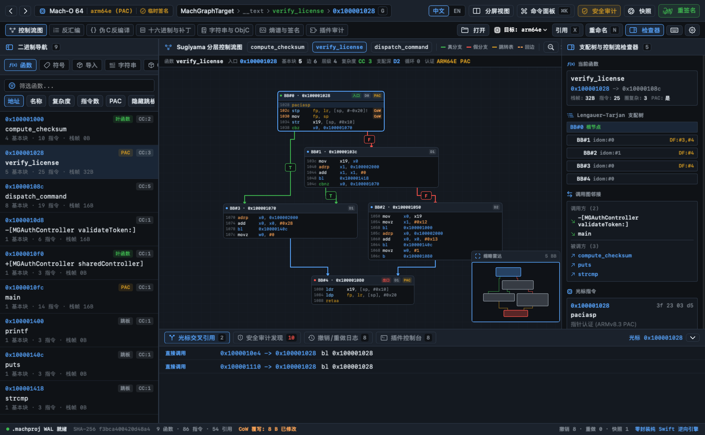
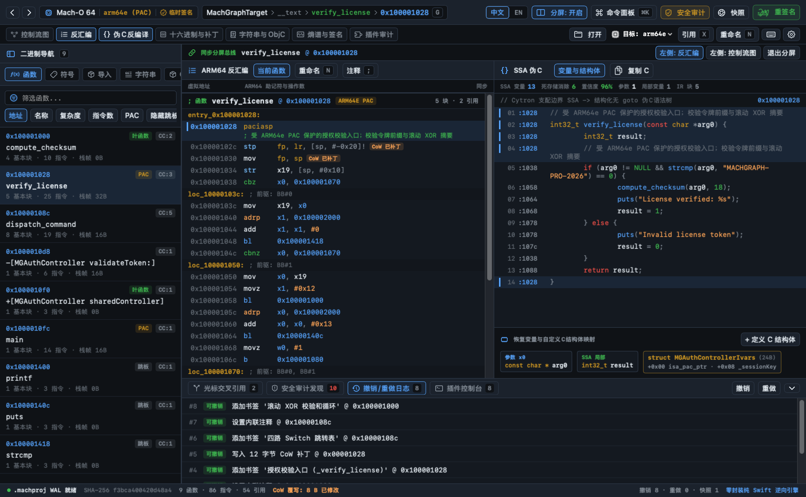
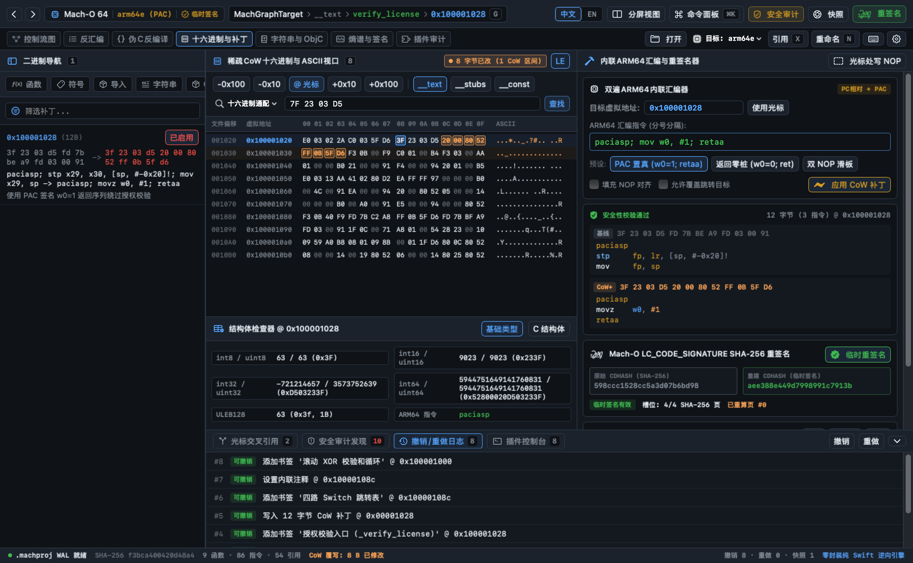
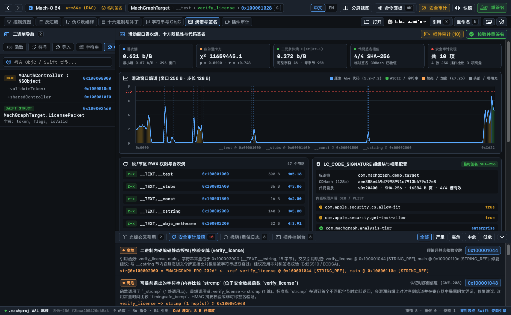

# MachGraph

**[English](README.md)** | **简体中文**

**零外部 CLI 封装的 macOS (Apple Silicon) 原生二进制逆向工程 IDE、ARM64 SSA 反编译器与字节补丁工作台 · `v1.1.0` 中英双语版 (`中文 / EN`)**



`MachGraph v1.1.0`（基于严格 Swift 6 并发安全模型构建，涵盖 11 个模块化核心库、原生桌面 IDE 与 145 项自动化测试，总计 `74,303` 行代码）是一款专为 Apple Silicon 打造的纯原生逆向工程工作台。**全套引擎完全在进程内原生实现，零外部调用 `otool`、`objdump`、`nm`、`llvm-mc` 或 `c++filt`**：从多容器二进制解析器、手写 ARM64/ARM64e PAC 指令解码器、双遍内联汇编器、Lengauer-Tarjan 支配树与 Sugiyama 零重叠控制流图布局求解器、Cytron SSA 微中间表示（Micro-IR）到无 `goto` 结构化伪 C 反编译器、稀疏写时复制（Sparse CoW）十六进制补丁引擎、Mach-O `LC_CODE_SIGNATURE` SHA-256 临时重签名器、`.machproj` SQLite WAL 持久化工程库，以及 `JavaScriptCore` 能力门控安全审计沙箱，均由纯 Swift 独立驱动。

### `v1.1.0` 核心更新
- **应用内实时 `中文 / EN` 双语热切换**：点击顶部冷钨钢工具栏 **`中文 | EN`** 胶囊开关、按快捷键 **`⇧⌘L`**（菜单栏 `切换语言 / Toggle Language`）或在 **`⌘,`** 偏好设置中切换，即可零重启实时重绘全部 7 大逆向工作区、命令面板与状态栏；支持 `--lang zh|en`、`MACHGRAPH_LANG=zh|en`、`UserDefaults` 记忆及简体中文系统环境自动识别。
- **中英双语单文件离线 HTML 逆向分诊报告**：导出的冷钨钢 HTML 分诊报告（`docs/demo-mach-triage.html`）内置右上角 **`中文 | EN`** 交互切换胶囊，支持 `localStorage` 偏好记忆与浏览器 `navigator.language` 中文自动默认。
- **2x Retina 高清中文工作台实拍图 (`2720 × 1680`)**：专门针对中文排版优化字距与胶囊留白，7 大分析面板与检查器实现 **0% 省略号截断**。

---

## 模块化架构（11 个 SwiftPM 核心模块 + 桌面/CLI 入口 + 测试套件，共 `74,303 LOC`）

| 模块 | 代码行数 | 核心职责 |
|---|---:|---|
| `MachBinaryFormats` | `9,200` | Universal Fat/Fat64、Mach-O 64、Dyld 链式修正（`ARM64E` PAC + `PTR_64`）、导出前缀树（Export Trie）、内嵌 `LC_CODE_SIGNATURE` CMS/DER/CDHash、ObjC 2.0 运行时与 Swift 5 类型描述符、ELF64、PE32+、WebAssembly 1.0 原生加载器 |
| `MachMicroDecompiler` | `8,868` | ARM64 -> Micro-IR 语义提升器、Cytron 支配边界 SSA $\phi$ 节点插入、死存储消除与拷贝传播、无 `goto` 结构化 `if / else / while / do-while / switch` 伪 C 生成器，以及可选 Ghidra 12.1.4 对照桥接 |
| `MachA64Decoder` | `8,817` | 手写 ARMv8-A / ARMv8.3-A（`arm64e` PAC 指针认证 + LSE 原子指令 + SIMD/浮点）解码器、双遍内联 ARM64 微型汇编器、`ADRP+ADD`/`ADRP+LDR` 惯用法识别器，以及纯 Swift `$s` / Itanium `_Z` / ObjC 符号反修饰器 |
| `MachCFGEngine` | `8,207` | 函数边界与 Switch 跳转表恢复、Lengauer-Tarjan 支配树与 `IDF+` 支配边界计算、自然循环检测、双向交叉引用（Xref）与调用图强连通分量（SCC）索引、Brandes-Köpf Sugiyama 零重叠分层控制流图布局 |
| `MachProjectStore` | `7,551` | `.machproj` SQLite3 WAL 工程持久化（`v1..v4` 校验和增量迁移）、双索引交叉引用查询、跨冷启动持久化的撤销/重做（Undo/Redo）事务日志、原子快照与差异对比、JSON / Ghidra / IDA / C 头文件 / Markdown 报告导出 |
| `MachStudioViews` | `7,382` | 无限平移缩放 Sugiyama 控制流图画布与缩略雷达、ARM64 反汇编 <-> SSA 伪 C 双向同步分屏工作台、16 列稀疏 CoW 十六进制与内联 ARM64 补丁器、字符串/ObjC/Swift 运行时浏览器、滑动窗口香农熵谱与代码签名工作台 |
| `MachPatchAndHexEngine` | `6,393` | $O(\log P)$ 稀疏写时复制字节覆写缓冲区、Horspool 掩码通配符搜索、带跳转目标安全性预检的内联 ARM64 补丁器与跳板（Veneer）桩生成、IPS/IPS32/BPS1 补丁编解码、Mach-O `CodeDirectory` SHA-256 页哈希重签名、香农熵与 $\chi^2$ 随机性剖析 |
| `MachWorkbenchShell` | `5,592` | 冷钨钢（Cold Tungsten Steel `#0F1216`）中英双语（`中文 / EN`）工作台外壳、跨面板同步 `VirtualAddress` 光标总线、`⌘K` 模糊搜索命令面板、`G` 地址/符号算术跳转解析器、`X` 交叉引用弹窗、`⌘,` 多标签偏好设置 |
| `MachGraphModels` | `3,638` | 零拷贝 `BinarySliceReader`、`VirtualAddress`/`FileOffset` 类型安全地址算术、ARM64 语法树、CFG/支配树/循环模型、SSA Micro-IR、伪 C AST、补丁与 SQLite WAL 领域模型、`MachLanguage` 与 `MachLocalizer` 双语引擎 |
| `MachPluginSDK` | `2,937` | 能力门控（Capability-Gated）`JavaScriptCore` 逆向插件沙箱，内置 4 款安全审计插件（硬编码密钥与授权令牌扫描器、危险 C 汇聚点可达性审计器、ARM64e PAC 与 JOP/ROP 检查器、macOS 权限声明与签名审计器） |
| `MachHeadlessCLI` | `1,194` | 15 子命令无头 CLI（支持 `--lang zh|en`）、面向 AI 编程代理的 JSON-RPC 2.0 MCP 服务器（`stdio`），以及 Hallmark 零告警冷钨钢中英双语单文件 HTML 逆向分诊报告导出器 |
| `MachGraph` + `MachGraphTests` | `4,524` | 统一桌面 IDE / CLI / MCP 可执行入口（`368` LOC）+ **覆盖 7 大测试套件的 145 项 Swift Testing `@Test` 自动化测试**（`4,156` LOC，约 `1.0s` 跑完，`0` 失败） |

---

## 2x Retina 高清中文工作台画廊 (`2720 × 1680`)

| Sugiyama 分层控制流图、Lengauer-Tarjan 支配树与缩略雷达 | ARM64 反汇编与无 `goto` SSA 伪 C 同步分屏工作台 |
|---|---|
|  |  |

| 稀疏 CoW 十六进制、双遍内联 ARM64 汇编与 SHA-256 重签名 | 滑动窗口香农熵谱、代码签名超级块与 JSC 安全审计 |
|---|---|
|  |  |

---

## 安装与源码编译

### Homebrew Cask 一键安装

```bash
brew tap zxu756/tap
brew install --cask zxu756/tap/machgraph
```

### 从源码构建 `.app` 应用包

```bash
git clone https://github.com/zxu756/MachGraph.git
cd MachGraph
swift test --no-parallel
./Scripts/build-app.sh
open build/MachGraph.app
```

### 语言解析优先级与热切换
`MachGraph` 按以下确定性优先级决定启动界面语言，并支持运行中随时按 **`⇧⌘L`** 或点击顶部 **`中文 | EN`** 胶囊无缝切换：
1. 命令行参数：`--lang zh` / `--lang en`
2. 环境变量：`MACHGRAPH_LANG=zh` / `MACHGRAPH_LANG=en`
3. 用户偏好持久化：`UserDefaults`（`io.github.zxu756.MachGraph.language`）
4. 系统首选语言：`Locale.preferredLanguages.first` 以 `"zh"` 开头时自动默认简体中文（`zh-Hans`），否则为英文（`en`）

---

## 无头命令行（Headless CLI）与 MCP 服务器用法

```bash
# 指定简体中文或英文直接启动桌面工作台（应用内可随时按 ⇧⌘L 切换）
MachGraph --lang zh
MACHGRAPH_LANG=en MachGraph

# 解析 Universal / Mach-O 64 / ELF64 / PE32+ / WASM 容器头、段映射、交叉引用计数与 CDHash
MachGraph info --binary /bin/ls

# 反汇编指定函数，自动标注 ADRP+ADD 页址折叠、ARM64e PAC 指令与交叉引用
MachGraph disasm --binary /bin/ls --function _main

# 将 ARM64 机器码经 Cytron SSA Micro-IR 提升为结构化无 goto 伪 C 代码
MachGraph decompile --binary /bin/ls --function _main

# 运行全部 4 款内置 JavaScriptCore 二进制安全审计插件
MachGraph audit-plugins --binary /bin/ls

# 导出单文件离线冷钨钢中英双语 (中文 | EN) HTML 二进制分诊报告
MachGraph export-html triage-report.html --binary /bin/ls

# 启动基于 stdio 的 JSON-RPC 2.0 MCP 服务器（可直接接入 Claude Code / Codex / OpenCode / Antigravity）
MachGraph mcp
```

---

## 开源许可

MIT License. Copyright (c) 2026 Xu (`zxu756`).
